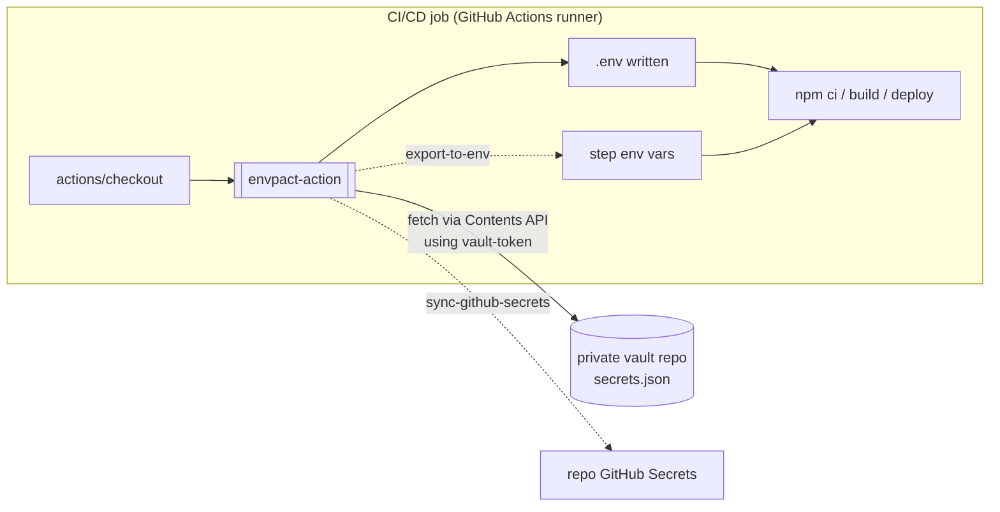

# envpact-action

> One vault, every workflow — resolve secrets from your private envpact vault and write a `.env` at the start of any CI/CD job, instead of copy-pasting the same key into 40 repo settings pages.

[](https://opensource.org/licenses/MIT)
[](https://github.com/chirag127/envpact-gh-action/stargazers)
[](https://github.com/chirag127/envpact-gh-action/commits)
[](https://nodejs.org)
[](https://github.com/chirag127/envpact-gh-action/actions/workflows/ci.yml)
[](https://github.com/marketplace/actions/envpact)
[](https://envpact-gh-action.oriz.in)

GitHub Action for **envpact** — resolve secrets from your private
vault and write a `.env` file at the start of every CI/CD job.

**Links:** [Repo](https://github.com/chirag127/envpact-gh-action) · [Live docs](https://envpact-gh-action.oriz.in) · [Marketplace](https://github.com/marketplace/actions/envpact) · [envpact umbrella](https://chirag127.github.io/envpact/)

> Stop maintaining 40 copies of `OPENAI_API_KEY` across 40
> repository secret pages. One vault, every workflow.

Part of the [envpact](https://github.com/chirag127/envpact)
ecosystem.

⭐ **If this is useful, please [star the repo](https://github.com/chirag127/envpact-gh-action/stargazers)** — it helps other developers find it.

## How it works



## Usage

```yaml
name: Deploy

on:
  push:
    branches: [main]

jobs:
  deploy:
    runs-on: ubuntu-latest
    steps:
      - uses: actions/checkout@v4

      - uses: chirag127/envpact-action@v0
        with:
          vault-repo: chirag127/envpact-secrets
          vault-token: ${{ secrets.ENVPACT_VAULT_TOKEN }}
          export-to-env: true

      - run: npm ci && npm run build && npm run deploy
        # All resolved secrets are exported as env vars for this step
```

## Inputs

| Input | Required | Default | Description |
| :--- | :---: | :--- | :--- |
| `vault-repo` | yes | — | Vault repository slug (e.g. `chirag127/envpact-secrets`). |
| `vault-token` | yes | — | PAT with read access to the vault repo. Pass via secrets. |
| `project-name` | no | repo name | Override the auto-detected project name. |
| `output-file` | no | `.env` | Where to write the resolved file. |
| `env-example` | no | `.env.example` | Path to `.env.example` for required-key ordering. |
| `export-to-env` | no | `false` | If `true`, also `core.exportVariable` each resolved key. |
| `sync-github-secrets` | no | `false` | If `true`, mirror resolved secrets into the current repo's GitHub Secrets. Requires `GH_ADMIN_TOKEN` env. |

## Outputs

| Output | Description |
| :--- | :--- |
| `resolved-count` | Number of secrets successfully resolved. |
| `env-file-path` | Path to the generated `.env`. |
| `unresolved-keys` | Comma-separated unresolved key names. |

## Migration from v0.2.x

The `environment` input was removed in **v0.3.0**. The vault schema
is now flat and single-environment per project (see
[SHARED_SPEC §1](https://github.com/chirag127/envpact/blob/main/_build/specs/SHARED_SPEC.md)).
Drop the line from your workflow:

```diff
   - uses: chirag127/envpact-action@v0
     with:
       vault-repo: chirag127/envpact-secrets
       vault-token: ${{ secrets.ENVPACT_VAULT_TOKEN }}
-      environment: production
```

**v1 / v2 vaults are auto-upgraded in memory on every run.** A
one-time warning is logged when the action sees a pre-v3 vault:

```
envpact: upgrading vault from v2 → v3. Per-environment values will
be flattened. Backup at pre-v3-migration branch (if you didn't make
one, abort now).
```

The on-disk vault file is **not** rewritten by the action — only
explicit pushes through `envpact-cli`, `envpact-mcp`, or the VS Code
extension persist the upgrade. For v2 vaults with multiple
environments per key, the action picks one value with priority
`default` → `production` → first non-empty. To keep multi-environment
isolation in v3, split into multiple project names (e.g.
`my-app-prod` / `my-app-dev`).

## Setup

### 1. Create your envpact vault

```bash
npx envpact-cli --init auto    # creates chirag127/envpact-secrets (private)
```

### 2. Create a fine-grained PAT for the vault

Visit
[github.com/settings/personal-access-tokens/new](https://github.com/settings/personal-access-tokens/new):

- Resource owner: your user.
- Repository access: **Only select repositories** → `envpact-secrets`.
- Repository permissions: **Contents: Read-only**.
- Expiration: 1 year (or your org policy).

### 3. Add the PAT to every consuming repository as a secret

```bash
gh secret set ENVPACT_VAULT_TOKEN --body "<paste-pat>" --repo chirag127/my-app
```

Or set it once at the **org** level so every repo inherits it:

```bash
gh secret set ENVPACT_VAULT_TOKEN --body "<paste-pat>" --org chirag127 --visibility all
```

### 4. Use the action in your workflow

See the example above. The action fetches `secrets.json` via the
GitHub Contents API (no full clone), resolves the requested
project, masks all values in logs, and writes `.env`.

## Security Model

- The action **masks every resolved value** via
  `core.setSecret()` so it cannot be accidentally logged.
- The fetched vault content stays in memory; only the resolved
  `.env` is written to disk.
- The default `vault-token` only needs read access to one repo.
- For `sync-github-secrets: true`, you also need an admin PAT in
  `GH_ADMIN_TOKEN` env — keep this scoped to the consuming repo.
- Encrypted (`enc:*`) values are **refused** by the action runtime
  (no decryption keys on the runner). Decrypt with `envpact-cli`
  before publishing the vault.
- Timestamps in the workflow log are rendered in **dual UTC + IST**
  format (`<ISO-UTC> (YYYY-MM-DD HH:MM:SS IST)`) per
  [SHARED_SPEC §1.5](https://github.com/chirag127/envpact/blob/main/_build/specs/SHARED_SPEC.md).
  The vault on-disk format is unchanged; this is a log-readability
  feature only and is independent of the runner's host timezone.

## Environment variables

The action's configuration is passed as **inputs** (documented above).
Two `env` values are read at runtime (names + purpose only):

| Env var | Purpose |
| :--- | :--- |
| `GH_ADMIN_TOKEN` | Admin PAT required only when `sync-github-secrets: true`, to mirror resolved secrets into the current repo's GitHub Secrets. Keep it scoped to the consuming repo. |
| `ENVPACT_VAULT_TOKEN` | Conventional secret name workflows use for the `vault-token` input (a read-only PAT for the vault repo). |

No secret values live in this repo.

## Tech stack

- **Node 20** action (`runs: node20`, entrypoint `dist/index.js`).
- Fetches the vault via the GitHub **Contents API** (no full clone).
- `dist/` is the compiled/bundled action committed for the runner.

## Repo structure

```
action.yml       # action metadata: inputs, outputs, runs (node20)
dist/index.js    # compiled action bundle (what the runner executes)
src/             # action source
docs/            # full reference (served at envpact-gh-action.oriz.in)
```

## Related projects — the envpact ecosystem

| Repo | Role |
| :--- | :--- |
| [envpact](https://github.com/chirag127/envpact) | Core (Python) vault library |
| [envpact-npm-cli](https://github.com/chirag127/envpact-npm-cli) | Zero-dependency Node CLI (`envpact-cli`) |
| [envpact-mcp-server](https://github.com/chirag127/envpact-mcp-server) | MCP server for AI agents |
| **envpact-gh-action** | GitHub Action — resolve secrets in CI (this repo) |
| [envpact-registry-publisher-npm-cli](https://github.com/chirag127/envpact-registry-publisher-npm-cli) | Publish MCP servers to every registry |

## Part of the oriz family

One of ~80 [oriz](https://blog.oriz.in) projects — small, sharp,
open-source tools. The live docs run **$0 on the Cloudflare free tier**.

## Contributing

PRs welcome. Conventional commits are the changelog.

## Status

**Stable.** Listed on the GitHub Marketplace as `envpact`.

## License

MIT © 2026 Chirag Singhal · chirag@oriz.in — see [LICENSE](./LICENSE).

## Documentation

- **[Repo docs (`docs/README.md`)](./docs/README.md)** — full API + usage reference for envpact-action
- **[Project umbrella site](https://chirag127.github.io/envpact/)** — overview of all envpact components, security model, quick start
- **[Live dashboard](https://envpact.oriz.in)** — visual vault management
